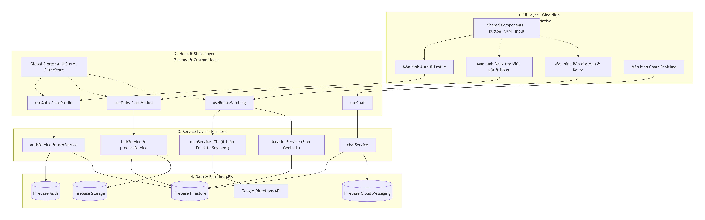

Sơ đồ Kiến trúc Tổng thể Hệ thống UniShare

Giải thích Kiến trúc Phân tầng (4-Layer Architecture):

1. UI Layer 		(Tầng Giao diện): Chịu trách nhiệm hiển thị các màn hình (Screens) và thành phần dùng chung (Shared Components). Tầng này tuyệt đối không gọi trực tiếp Firebase hay xử lý thuật toán phức tạp.
2. Hook & State Layer 	(Tầng Quản lý trạng thái): Đóng vai trò cầu nối giữa Giao diện và Nghiệp vụ. Sử dụng Zustand để lưu trữ state toàn cục nhẹ nhàng (như thông tin phiên đăng nhập `AuthStore`, bộ lọc `FilterStore`) và các Custom Hooks (useState, useEffect) để cung cấp dữ liệu cho UI.
3. Service Layer 		(Tầng Nghiệp vụ - Business Logic): Chứa toàn bộ lõi xử lý của ứng dụng. 
   - `mapService.ts`: Giải mã Polyline và chạy thuật toán hình học Point-to-Segment cho bài toán Route Matching.
   - `locationService.ts`: Chuyển đổi tọa độ GPS thành chuỗi Geohash và tính toán vùng Bounding Box.
   - `taskService.ts` / `productService.ts`: Xử lý CRUD và upload ảnh cho Bảng việc vặt, Gia sư và Chợ đồ cũ.
4. Data Layer 		(Tầng Dữ liệu & Dịch vụ ngoài): Nơi giao tiếp trực tiếp với hệ sinh thái Firebase (Auth, Firestore, Storage, FCM) và Google Directions API.

Ưu điểm của kiến trúc 
- Tính độc lập (Decoupling): Sửa đổi giao diện không làm hỏng logic thuật toán bên dưới.
- Tái sử dụng cao: Hàm sinh Geohash ở `locationService` có thể dùng chung cho cả tính năng Việc vặt lẫn Chợ đồ cũ.
- Clean Code: Dễ dàng phân chia công việc cho các thành viên trong nhóm (người code UI, người viết hàm Service thuật toán) mà không bị xung đột (conflict) code trên Git.