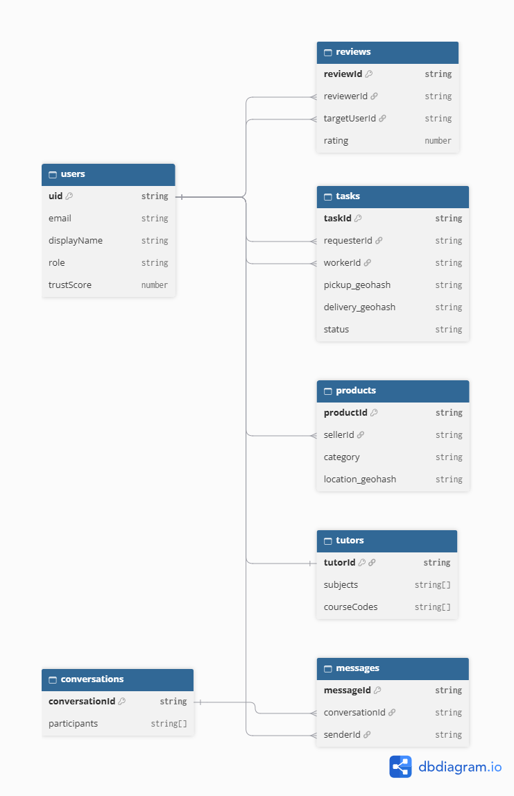

THIẾT KẾ KIẾN TRÚC DATABASE (FIRESTORE) - BẢN CHUẨN
1. Tư duy thiết kế NoSQL
Cache dữ liệu (Denormalization): Lưu sẵn requesterName, workerName vào tasks để không phải query bảng users.
Subcollection: Dùng cho messages để tránh file document quá lớn.
Geohash: Dùng để query không gian (vị trí) vì Firestore không hỗ trợ query 2D trực tiếp.

2. Cấu trúc các Collection (Bảng)
2.1. Collection: users
json
{
  "uid": "string",
  "email": "string (đuôi .edu.vn)",
  "displayName": "string",
  "avatarUrl": "string | null",
  "bio": "string",
  "phone": "string",
  "role": "user | admin",
  "status": "active | banned",
  "trustScore": "number (0.0 - 5.0)",
  "totalReviews": "number",
  "createdAt": "number"
}
2.2. Collection: tasks (Bảng việc vặt)
json
{
  "taskId": "string",
  "title": "string",
  "description": "string",
  "requesterId": "string",
  "requesterName": "string (cache)",
  "requesterAvatar": "string (cache)",
  "bounty": "number (VNĐ)",
  "paymentMethod": "cash | transfer | exchange",
  "pickupLocation": { "latitude": "number", "longitude": "number", "geohash": "string", "address": "string" },
  "deliveryLocation": { "latitude": "number", "longitude": "number", "geohash": "string", "address": "string" },
  "status": "open | matched | completed | cancelled",
  "estimatedTime": "number",
  "imageUrls": ["string"],
  "workerId": "string | null",
  "workerName": "string | null",
  "createdAt": "number"
}
2.3. Collection: products (Chợ đồ cũ)
json
{
  "productId": "string",
  "title": "string",
  "description": "string",
  "price": "number",
  "isFree": "boolean",
  "category": "book | electronic | furniture | clothing | other",
  "condition": "new | like-new | used | broken",
  "imageUrls": ["string"],
  "sellerId": "string",
  "sellerName": "string",
  "location": { "latitude": "number", "longitude": "number", "geohash": "string", "address": "string" },
  "status": "available | sold | hidden",
  "createdAt": "number"
}
2.4. Collection: conversations & Subcollection messages
conversations:

json
{
  "conversationId": "string",
  "participants": ["uid1", "uid2"],
  "participantNames": ["Tên 1", "Tên 2"],
  "lastMessage": "string",
  "lastMessageAt": "number",
  "relatedType": "task | product | tutor | null",
  "relatedId": "string | null",
  "createdAt": "number"
}
messages (Subcollection của conversation):

json
{
  "messageId": "string",
  "senderId": "string",
  "senderName": "string",
  "content": "string",
  "imageUrl": "string | null",
  "createdAt": "number"
}
2.5. Collection: tutors (Gia sư - Dành cho đối tượng là Sinh viên ĐH)

json
{
  "tutorId": "string (trùng uid)",
  "displayName": "string",
  "avatarUrl": "string | null",
  "university": "string (VD: UIT)",
  "subjects": ["Nhập môn Lập trình", "Giải tích 1"],
  "courseCodes": ["IT001", "MA001"],
  "feeType": "hourly | per_session | free_exchange",
  "feeAmount": "number",
  "bio": "string",
  "trustScore": "number",
  "totalReviews": "number",
  "createdAt": "number"
}
2.6. Collection: reviews (Đánh giá)
json
{
  "reviewId": "string",
  "reviewerId": "string",
  "reviewerName": "string",
  "targetUserId": "string",
  "rating": "number (1-5)",
  "comment": "string",
  "relatedType": "task | product | tutor",
  "relatedId": "string",
  "createdAt": "number"
}
3. Cấu hình Composite Indexes 
Lưu ý: Không sort createdAt trên server khi đang dùng geohash. Phải sort ở Client.

Index 1: Query Bảng tin / Map (Việc vặt)

Collection: tasks

Fields: status (Ascending) + pickupLocation.geohash (Ascending)

Index 2: Query Chợ đồ cũ

Collection: products

Fields: status (Ascending) + category (Ascending) + location.geohash (Ascending)

Index 3: Query Chat

Collection: conversations

Fields: participants (Array-contains) + lastMessageAt (Descending)

4. Firestore Security Rules (Đã mở luồng Nhận việc & Đánh giá)
javascript
rules_version = '2';
service cloud.firestore {
  match /databases/{database}/documents {
    
    function isSignedIn() {
      return request.auth != null;
    }
    
    function isAdmin() {
      return isSignedIn() && 
        get(/databases/$(database)/documents/users/$(request.auth.uid)).data.role == 'admin';
    }

    match /users/{userId} {
      allow read: if isSignedIn();
      allow create: if isSignedIn() && request.auth.uid == userId;
      // Cho phép update điểm trustScore hoặc profile
      allow update: if isSignedIn(); 
      allow delete: if isAdmin();
    }

    match /tasks/{taskId} {
      allow read, create: if isSignedIn();
      // FIX LỖI: Cho phép worker nhận việc (update status thành matched)
      allow update: if isSignedIn() && (
        resource.data.requesterId == request.auth.uid || 
        resource.data.status == 'open' || 
        resource.data.workerId == request.auth.uid || 
        isAdmin()
      );
      allow delete: if isSignedIn() && (resource.data.requesterId == request.auth.uid || isAdmin());
    }

    match /products/{productId} {
      allow read, create: if isSignedIn();
      allow update, delete: if isSignedIn() && (resource.data.sellerId == request.auth.uid || isAdmin());
    }

    match /tutors/{tutorId} {
      allow read: if isSignedIn();
      allow create, update, delete: if isSignedIn() && (request.auth.uid == tutorId || isAdmin());
    }

    match /reviews/{reviewId} {
      allow read, create: if isSignedIn();
      allow update, delete: if isSignedIn() && (resource.data.reviewerId == request.auth.uid || isAdmin());
    }

    match /conversations/{conversationId} {
      allow read, update: if isSignedIn() && request.auth.uid in resource.data.participants;
      allow create: if isSignedIn();
      
      match /messages/{messageId} {
        allow read, create: if isSignedIn() && 
          request.auth.uid in get(/databases/$(database)/documents/conversations/$(conversationId)).data.participants;
      }
    }
  }
}
5. Sơ đồ ERD 
