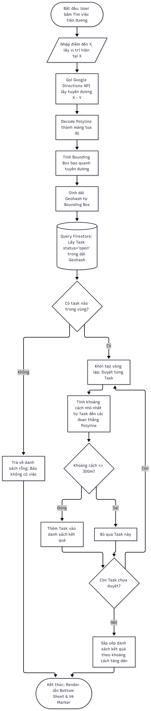

Sơ đồ luồng: Thuật toán ghép tuyến đường (Route Matching)

Giải thích các bước:
1. Lấy dữ liệu API Google Maps trả về tuyến đường dưới dạng Polyline.
2. Lọc thô (Bounding Box + Geohash)Thay vì tải toàn bộ task trên server về, ta tính một hình chữ nhật bao quanh tuyến đường, lấy các task nằm trong hình chữ nhật này (dùng Geohash để query Firestore cho nhanh).
3. Lọc tinh (Point-to-Segment)Với các task đã lấy được, dùng toán học tính khoảng cách từ vị trí task đến các đoạn đường. Chỉ giữ lại task cách đường <= 300m.
4. Sắp xếp Task gần nhất hiển thị lên đầu tiên.